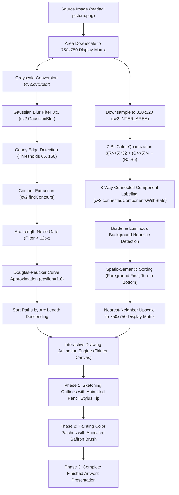

# 🕉️ Matadi Python Sketch (Maa Skandamata)

[](https://github.com/saikatbarman07)
[](https://www.python.org/)
[](https://opencv.org/)
[](https://numpy.org/)
[](https://docs.python.org/3/library/tkinter.html)
[](./LICENSE)

An interactive computer vision and digital art animation engine designed and developed by **SAIKAT BARMAN**. The application programmatically reconstructs and animates the drawing and painting of **Maa Skandamata** (the sacred fifth form of Goddess Durga worshiped during Navratri).

The engine decomposes an input reference illustration into vector line contours and 7-bit quantized color regions, then simulates the creation process stroke-by-stroke and patch-by-patch in real time on an interactive desktop canvas.

## 🌺 About

> A divine sketch of Maa Durga, brought to life with colors, devotion, and love. ❤️🙏  
> 
> Every stroke reflects faith, every color tells a story of divine power. 🎨✨  
> 
> A small tribute to the eternal strength, grace, and blessings of Maa Durga. 🌺🔱  
> 
> **Jai Mata Di! ❤️🦁**

---

## 🛠️ Complete Technology Stack & Tools Used

Every component, library, and technique used to build this project was chosen for optimal desktop performance, zero disk I/O during rendering, and high visual quality:

| Category | Technology / Library | Purpose & Implementation in Project |
| :--- | :--- | :--- |
| **Language** | **Python 3.8+** | Core programming language powering the entire processing pipeline and desktop UI. |
| **Computer Vision** | **OpenCV (`cv2`)** | • BGR to Grayscale conversion (`cv2.cvtColor`)<br>• Gaussian blur filtering (`cv2.GaussianBlur`)<br>• Canny edge gradient detection (`cv2.Canny`)<br>• Boundary contour extraction (`cv2.findContours`)<br>• Arc length perimeter calculation (`cv2.arcLength`)<br>• Douglas-Peucker curve polygon approximation (`cv2.approxPolyDP`)<br>• Area downsampling (`cv2.INTER_AREA`) and Nearest-Neighbor scaling (`cv2.INTER_NEAREST`)<br>• 8-way Connected Component analysis with statistics (`cv2.connectedComponentsWithStats`)<br>• In-memory PNG byte stream encoding (`cv2.imencode`)<br>• Anti-aliased line rendering (`cv2.line` with `cv2.LINE_AA`) |
| **Numerical Computing** | **NumPy (`numpy`)** | • Multi-dimensional matrix array storage and slicing<br>• Fast 7-bit color space bit-shifting (`>> 5`, `>> 6`) and scalar multiplication<br>• Label mask indexing and boolean array filtering<br>• Blank white canvas buffer initialization (`np.full_like(preview, 255)`) |
| **User Interface** | **Tkinter & Ttk** | • Window container and event loop management (`tk.Tk`, `root.mainloop`)<br>• Double-buffered vector drawing canvas (`tk.Canvas`)<br>• Live in-memory graphic rendering via `tk.PhotoImage`<br>• Interactive UI control widgets: Pause/Resume button, Restart button, Speed scale slider (`ttk.Scale`), Dynamic status label (`ttk.Label`)<br>• Keyboard event listener bindings (`<space>`, `<r>`, `<R>`) |
| **Data Streaming** | **Base64 (`base64`)** | In-memory binary-to-ASCII encoding (`base64.b64encode`) of OpenCV compressed image buffers directly into Tkinter's PhotoImage format, eliminating disk read/write latency. |
| **Path & System** | **Pathlib (`pathlib.Path`)** | Platform-independent filesystem path resolution for project files, references, and assets across Windows, Linux, and macOS. |
| **Version Control** | **Git & GitHub CLI (`gh`)** | Clean single-root commit versioning and automated repository management. |

---

## 🏗️ Architecture & Pipeline Flow



---

## 🎨 Complete Techniques & Algorithms Explained

### 1. Image Preprocessing & Edge Detection
- **Grayscale Conversion**:  
  Translates standard 3-channel BGR pixels into luminance values using the ITU-R 601-2 luma formula ($Y = 0.299R + 0.587G + 0.114B$). This discards chromatic variance to isolate structural contrast gradients.
- **Gaussian Blur ($3 \times 3$ Kernel)**:  
  Convolves the grayscale image with a $3 \times 3$ Gaussian smoothing filter ($\sigma = 0$). This eliminates high-frequency camera/scanner noise and texture grain without degrading essential line edges.
- **Canny Edge Detection (Dual Thresholding: 65 & 150)**:  
  Applies non-maximum suppression along spatial gradients followed by hysteresis thresholding:
  - Gradients $> 150$ are marked as definite edges.
  - Gradients between $65$ and $150$ are preserved only if connected to definite edges.
  - Gradients $< 65$ are discarded as background noise.
- **Contour Extraction (`cv2.RETR_LIST`, `cv2.CHAIN_APPROX_NONE`)**:  
  Traverses the binary edge map, storing every boundary pixel sequentially as continuous vector chains.
- **Arc-Length Noise Gate**:  
  Calculates the perimeter length of each extracted contour with `cv2.arcLength(contour, False)`. Contours shorter than $12$ pixels are discarded to avoid rendering stray flecks.
- **Douglas-Peucker Polygonal Curve Approximation**:  
  Compresses dense contour vertices with an epsilon tolerance of $1.0$ px using `cv2.approxPolyDP`. Collinear and micro-jitter points are merged while retaining visual curvature.
- **Descending Stroke Hierarchy Sorting**:  
  Sorts stroke paths in descending order of contour length so the primary outer silhouettes and figures are drawn first, followed progressively by finer decorative details.

---

### 2. Color Quantization & Region Segmentation
- **Downscaling to $320 \times 320$ Matrix**:  
  Downsamples the image to a standardized segmentation resolution using area interpolation (`cv2.INTER_AREA`), averaging adjacent pixel colors to prevent pixelation during clustering.
- **Custom 7-Bit / 256-Bin Color Quantization**:  
  Reduces 24-bit TrueColor depth (16.7 million colors) into 256 discrete color buckets using high-performance bitwise shifting:
  $$\text{Color ID} = (R \gg 5) \times 32 + (G \gg 5) \times 4 + (B \gg 6)$$
  - **Red Channel**: Top 3 bits preserved ($2^3 = 8$ levels: $0, 32, 64, 96, 128, 160, 192, 224$).
  - **Green Channel**: Top 3 bits preserved ($2^3 = 8$ levels: $0, 32, 64, 96, 128, 160, 192, 224$).
  - **Blue Channel**: Top 2 bits preserved ($2^2 = 4$ levels: $0, 64, 128, 192$).
- **8-Way Connected Component Labeling**:  
  Applies `cv2.connectedComponentsWithStats` with 8-connectivity over each color mask, assigning individual IDs to distinct, non-contiguous color regions across the image.
- **Border & Background Heuristic Detection**:  
  Identifies whether a component touches the outer image boundary ($x=0$, $y=0$, $x+w = 320$, or $y+h = 320$) and spans a large area ($\ge 4 \times 320 = 1280$ pixels). If the mean intensity across channels satisfies $\min(\text{mean\_color}) \ge 190$, it is classified as background.
- **Spatio-Semantic Painting Order**:  
  Sorts regions so that:
  1. Main subject regions are painted first (`is_background = False`).
  2. Outer background patches are painted last (`is_background = True`).
  3. Within each group, regions are painted in spatial reading order (top-to-bottom $y$, left-to-right $x$).
- **Nearest-Neighbor Matrix Upscaling**:  
  Upscales the discrete label matrix to the $750 \times 750$ display size using `cv2.INTER_NEAREST`, preserving sharp, unblurred region boundaries.

---

### 3. Interactive Desktop GUI & Real-Time Animation Pipeline
- **Asynchronous Non-Blocking Scheduling (`root.after`)**:  
  Maintains responsive UI interactions by scheduling frame rendering batches through Tkinter's event loop rather than blocking `while` loops or sleep calls.
- **In-Memory Base64 Frame Streaming**:  
  Modified OpenCV frames are compressed to PNG in RAM with `cv2.imencode`, encoded with `base64.b64encode`, and passed directly to `self.image.configure(data=...)`. Zero files are written to disk during playback.
- **Adaptive Stroke Thickness**:  
  Line thickness dynamically adapts based on contour length:
  - Short detail strokes ($< 50$ px): `1 px`
  - Medium contours ($50$ to $249$ px): `2 px`
  - Major structural outlines ($\ge 250$ px): `3 px`
  All lines are rendered with anti-aliasing (`cv2.LINE_AA`).
- **Simulated Tool Cursors**:
  - **Golden Pencil Stylus**: An angled, diamond-polygon pen stylus (`#F2C14E`) following the active stroke during Phase 1.
  - **Saffron Round Paintbrush**: A circular brush head (`#D36B36`, radius $8$ px) centered over each active color region during Phase 2.

---

## 🎨 Complete Colour Specifications

### 1. Inking & Canvas Colours
| Element | Color Name | Hex Code | RGB | BGR (OpenCV) | Purpose |
| :--- | :--- | :--- | :--- | :--- | :--- |
| **Sketch Ink** | Charcoal Graphite | `#1B1E22` | `rgb(27, 30, 34)` | `(34, 30, 27)` | Hand-drawn pencil/ink stroke lines |
| **Canvas** | Pure Studio White | `#FFFFFF` | `rgb(255, 255, 255)` | `(255, 255, 255)` | Blank background drawing surface |

### 2. Interactive Tool Cursor Colours
| Tool | Element | Hex Code | RGB | Dimensions & Geometry |
| :--- | :--- | :--- | :--- | :--- |
| **Pencil Stylus** | Body Fill | `#F2C14E` | `rgb(242, 193, 78)` | Angled polygon tip, 2px border |
| **Pencil Stylus** | Outline Edge | `#30251B` | `rgb(48, 37, 27)` | Deep bronze contrast outline |
| **Paintbrush** | Brush Head | `#D36B36` | `rgb(211, 107, 54)` | Circular head, radius 8px |
| **Paintbrush** | Brush Outline | `#4B2B1B` | `rgb(75, 43, 27)` | Rich mahogany border, 3px stroke |

### 3. Subject Palette (Maa Skandamata - Navratri Day 5 Sacred Colors)
| Color Tone | Hex Code | Spiritual & Artistic Significance |
| :--- | :--- | :--- |
| **Sacred Royal Yellow** | `#F4C430` / `#E5A93B` | The primary auspicious color dedicated to Maa Skandamata on Day 5 of Navratri, symbolizing radiant intellect, solar energy, and spiritual illumination. |
| **Lotus Blossom Pink** | `#F4A6B8` / `#E87A90` | Colors the sacred lotus flowers held by the Goddess and the lotus seat (Padmasana). |
| **Celestial Lion Ochre** | `#C68642` / `#8D5524` | Textures the brave lion mount (Vahana) with warm golden, amber, and mane shadow tones. |
| **Luminous Pearl & Peach** | `#F9DCC4` / `#E8C5A5` | Graceful, warm divine skin tones. |
| **Radiant Aura Ivory** | `#FFF8E7` / `#F0E6D2` | Soft celestial halo and backdrop luminance surrounding the deity. |

### 4. 7-Bit Quantization Allocation Breakdown
| Channel | Preserved Bits | Quantized Steps | Step Increment | Mathematical Bit-Shift |
| :---: | :---: | :---: | :---: | :--- |
| **Red (R)** | 3 bits | 8 levels | 32 | `(R >> 5) * 32` |
| **Green (G)** | 3 bits | 8 levels | 32 | `(G >> 5) * 4` |
| **Blue (B)** | 2 bits | 4 levels | 64 | `(B >> 6) * 1` |
| **Combined** | **7 bits** | **256 distinct color bins** | - | `(R>>5)*32 + (G>>5)*4 + (B>>6)` |

---

## ⚙️ Configuration Parameters in Code

The following constants in `matadi.py` control the resolutions, tolerances, and speeds:

```python
DISPLAY_SIZE = 750           # Active Tkinter animation canvas size (750x750 px)
SEGMENTATION_SIZE = 320      # Downscaled resolution for fast color quantization (320x320 px)
CANVAS_MARGIN = 20           # Outer canvas padding in pixels

# Drawing & Filter Thresholds
CANNY_LOW = 65               # Canny lower gradient threshold
CANNY_HIGH = 150             # Canny upper gradient threshold
GAUSSIAN_KERNEL = (3, 3)     # Noise smoothing kernel size
CONTOUR_MIN_LENGTH = 12      # Minimum perimeter in pixels to accept a contour
DOUGLAS_PEUCKER_EPS = 1.0    # Polygonal simplification tolerance
BG_LUMINANCE_MIN = 190       # Minimum mean intensity for border background heuristic
```

---

## 🚀 Installation & Execution

### Prerequisites
- Python 3.8 or higher installed on your machine.
- Tkinter (included by default in Python for Windows and macOS; on Linux, install via `sudo apt install python3-tk`).

### Step-by-Step Setup

1. **Clone the repository**:
   ```bash
   git clone https://github.com/saikatbarman07/Mata-python-sketch.git
   cd Mata-python-sketch
   ```

2. **(Optional) Create and activate a virtual environment**:
   ```bash
   python -m venv .venv
   # Windows:
   .venv\Scripts\activate
   # macOS/Linux:
   source .venv/bin/activate
   ```

3. **Install required dependencies**:
   ```bash
   python -m pip install opencv-python numpy
   ```

4. **Verify that the reference picture exists**:
   Ensure `madadi picture.png` is in the same folder as `matadi.py`.

5. **Launch the application**:
   ```bash
   python matadi.py
   ```

---

## ⌨️ Controls & Shortcuts

| Control | Action | Details |
| :--- | :--- | :--- |
| **`Spacebar`** or **Pause Button** | Pause / Resume | Freezes or unfreezes stroke rendering at the exact current position. |
| **`R` Key** or **Restart Button** | Restart / Replay | Clears the canvas buffer and restarts the animation from stroke 0. |
| **Speed Slider** | Live Speed Adjustment | Dynamically adjusts the speed multiplier from `0.5x` (slow motion) to `8.0x` (ultra fast). |
| **Status Label** | Real-Time Counter | Displays exact live stroke count (`X / Total strokes`) and region count (`Y / Total regions`). |

---

## 📂 Project Structure

```
Mata-python-sketch/
├── matadi.py                 # Core engine (CV pipeline, color quantization, Tkinter GUI)
├── madadi picture.png        # Source reference artwork of Maa Skandamata
├── .gitignore                # Security, cache, and artifact ignore rules
├── LICENSE                   # MIT License (Copyright (c) 2026 SAIKAT BARMAN)
└── README.md                 # Complete technical documentation & specifications
```

---

## 👤 Author & Maintainer

**SAIKAT BARMAN**
- GitHub Profile: [@saikatbarman07](https://github.com/saikatbarman07)
- Repository: [saikatbarman07/Mata-python-sketch](https://github.com/saikatbarman07/Mata-python-sketch)

---

## 📄 License

This project is licensed under the **MIT License**.  
See the [LICENSE](./LICENSE) file for complete details.  
Copyright (c) 2026 SAIKAT BARMAN.
