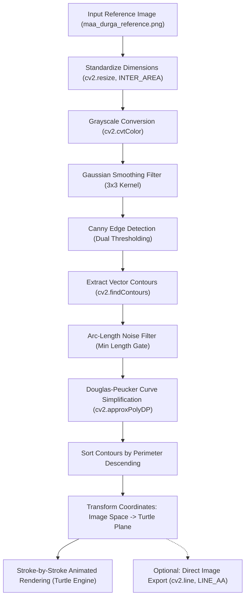

# 🕉️ Maa Durga Python Sketch Generator

[](https://github.com/saikatbarman07)
[](https://www.python.org/)
[](https://opencv.org/)
[](https://docs.python.org/3/library/turtle.html)
[](./LICENSE)

A modular computer vision and generative vector art pipeline designed and maintained by **Saikat Barman** ([@saikatbarman07](https://github.com/saikatbarman07)). The engine extracts high-fidelity structural contours from raster artwork using OpenCV and animates the drawing process stroke-by-stroke in real time using Python's standard Turtle graphics library.

---

## 🌺 Overview

> A digital tribute to the divine grace and eternal power of **Maa Durga**. 🎨🙏  
> Every stroke is calculated mathematically through edge gradients, transforming a raster image into continuous vector curves brought to life right before your eyes. ✨

The project decomposes a reference illustration (`maa_durga_reference.png`) into simplified polygonal contours and renders them sequentially onto an interactive canvas. Major anatomical features and prominent silhouettes are drawn first, followed progressively by intricate ornamental details.

---

## ✨ Features

- **Automated Contour Extraction**: Converts raster illustrations into continuous vector paths using Gaussian filtering, Canny edge detection, and Douglas-Peucker polygonal approximation.
- **Hierarchical Path Sorting**: Automatically sorts detected paths by arc length, ensuring that principal structural outlines are sketched before fine decorative lines.
- **Dynamic Coordinate Mapping**: Translates OpenCV's top-left origin image coordinate system to Turtle's centered Cartesian plane with sub-pixel precision.
- **Real-Time Interactive Animation**: Configurable drawing speeds with optimized tracer batching to prevent canvas stuttering and freezing.
- **Customizable Aesthetics**: Easily personalize canvas background color, pen ink color, stroke width, and Canny sensitivity thresholds via command-line arguments.
- **Headless Export Option**: Generate and save clean, anti-aliased sketch images directly to disk without needing to launch the Turtle GUI.
- **Robust Path Resolution**: Uses `pathlib.Path` to resolve asset paths relative to the script's location, eliminating broken path errors regardless of your terminal's current working directory.

---

## 🏗️ How the Pipeline Works

The sketching pipeline operates in four coordinated stages:



### 1. Image Preprocessing & Filtering
- The reference image is loaded and scaled to a standardized canvas resolution (default: $750 \times 750\text{ px}$).
- The 3-channel BGR matrix is converted to single-channel grayscale luminance.
- A $3 \times 3$ Gaussian blur kernel suppresses camera artifacts, sensor grain, and micro-textures without softening dominant structural edges.

### 2. Edge Gradient Detection & Vectorization
- **Canny Edge Detection**: Identifies sharp luminance gradients using hysteresis thresholding (configurable via `--threshold1` and `--threshold2`).
- **Contour Retrieval**: Traces binary edge boundaries into ordered chains of $(x, y)$ coordinates.
- **Noise Suppression**: Discards any contour whose arc length is below a minimum perimeter threshold (default: $15\text{ px}$).
- **Douglas-Peucker Simplification**: Reduces redundant vertices along smooth curves with a customizable tolerance ($\epsilon = 1.0$).

### 3. Coordinate Space Transformation
OpenCV indexes coordinates with the origin $(0, 0)$ at the **top-left** corner (where $Y$ increases downwards). In contrast, Python's Turtle engine places the origin $(0, 0)$ at the **center** of the canvas (where $Y$ increases upwards).

The generator performs coordinate transformation for every vertex $(x, y)$ on a canvas of dimension $S$:
$$x_{\text{turtle}} = x - \frac{S}{2}$$
$$y_{\text{turtle}} = \frac{S}{2} - y$$

### 4. Interactive Turtle Rendering
- Contours are sorted in descending order of perimeter so the main figure outlines are drawn first.
- The virtual pen lifts (`penup()`), navigates to the starting vertex of each contour, lowers (`pendown()`), and traces every point in the curve.
- Screen tracer batching (`screen.tracer()`) refreshes frames smoothly without locking the GUI event loop.

---

## 🛠️ Technology Stack

| Component | Technology | Role in Project |
| :--- | :--- | :--- |
| **Language** | Python 3.8+ | Core scripting, typing, and CLI parsing. |
| **Computer Vision** | OpenCV (`cv2`) | Image loading, grayscale transformation, Gaussian blur, Canny edge detection, and contour extraction. |
| **Vector Rendering** | Python `turtle` | Real-time stroke-by-stroke animation, canvas management, and user interaction. |
| **Numerical Processing** | NumPy (`numpy`) | Array operations and matrix handling. |
| **Path Handling** | Python `pathlib` | Platform-independent dynamic asset path resolution. |

---

## 🚀 Installation & Setup

### 1. Clone the Repository
```bash
git clone https://github.com/saikatbarman07/Mata-python-sketch.git
cd Mata-python-sketch
```

### 2. (Optional) Create a Virtual Environment
```bash
# Windows
python -m venv .venv
.venv\Scripts\activate

# macOS / Linux
python3 -m venv .venv
source .venv/bin/activate
```

### 3. Install Required Dependencies
```bash
pip install opencv-python numpy
```
*(Note: `turtle` and `argparse` are standard built-in Python modules and require no external installation).*

---

## 💻 Usage

### Default Run
Launch the application with all standard configurations:
```bash
python matadi.py
```

### Command-Line Customization Options
You can customize the appearance, speed, and extraction thresholds directly from the command line:

```bash
# Dark theme with gold drawing pen
python matadi.py --bg-color "#121212" --pen-color "#F4C430"

# Adjust drawing speed (0 = fastest batching, 1-10 = stepped speed)
python matadi.py --speed 3

# Fine-tune Canny edge detection thresholds
python matadi.py --threshold1 80 --threshold2 180

# Increase stroke width for bolder lines
python matadi.py --pen-size 2

# Export a clean sketch preview image without launching the GUI
python matadi.py --no-gui --save-preview "durga_sketch.png"

# Specify a custom input reference image
python matadi.py --image "path/to/custom_image.png"
```

### CLI Reference

| Flag | Shorthand | Type | Default | Description |
| :--- | :---: | :---: | :---: | :--- |
| `--image` | `-i` | `Path` | `maa_durga_reference.png` | Path to input reference image file. |
| `--bg-color` | `--bg` | `str` | `#FFFFFF` | Canvas background color (hex string or color name). |
| `--pen-color` | `--color` | `str` | `#1B1E22` | Sketch stroke ink color (hex string or color name). |
| `--pen-size` | - | `int` | `1` | Pen stroke width in pixels. |
| `--speed` | `-s` | `int` | `0` | Drawing speed (`0` for fastest animation, `1`-`10` for slower steps). |
| `--threshold1` | - | `int` | `100` | Lower hysteresis threshold for Canny edge detection. |
| `--threshold2` | - | `int` | `200` | Upper hysteresis threshold for Canny edge detection. |
| `--min-length` | - | `int` | `15` | Minimum contour perimeter in pixels to render (filters noise). |
| `--epsilon` | - | `float` | `1.0` | Douglas-Peucker polygon approximation tolerance. |
| `--canvas-size` | - | `int` | `750` | Square window dimension in pixels. |
| `--save-preview` | - | `Path` | `None` | Save an anti-aliased sketch image directly to the specified path. |
| `--no-gui` | - | `flag` | `False` | Run headlessly without opening the Turtle window. |
| `--help` | `-h` | `flag` | - | Show command-line help message and exit. |

---

## 🐍 Programmatic Python API

The refactored `SketchGenerator` class can easily be imported into other Python projects:

```python
from pathlib import Path
from matadi import SketchGenerator

# Initialize the sketch generator
generator = SketchGenerator(
    image_path=Path("maa_durga_reference.png"),
    canvas_size=750,
    bg_color="#FFFFFF",
    pen_color="#1B1E22",
    pen_size=1,
    speed=0,
    threshold1=100,
    threshold2=200,
)

# Extract contours and render in Turtle
generator.extract_contours()
generator.render()

# Or export an anti-aliased preview directly
generator.export_preview("sketch_output.png")
```

---

## 📂 Project Structure

```
Mata-python-sketch/
├── matadi.py                # Core SketchGenerator engine & CLI interface
├── maa_durga_reference.png  # Standardized reference illustration
├── .gitignore               # Environment, cache, and artifact exclusions
├── LICENSE                  # MIT License (Copyright (c) 2026 Saikat Barman)
└── README.md                # Comprehensive project documentation
```

---

## 👤 Maintainer

**Saikat Barman**  
- GitHub: [@saikatbarman07](https://github.com/saikatbarman07)  
- Repository: [saikatbarman07/Mata-python-sketch](https://github.com/saikatbarman07/Mata-python-sketch)

---

## 📄 License

This project is licensed under the **MIT License**.  
See the [LICENSE](./LICENSE) file for complete terms.  
Copyright (c) 2026 **Saikat Barman**.
